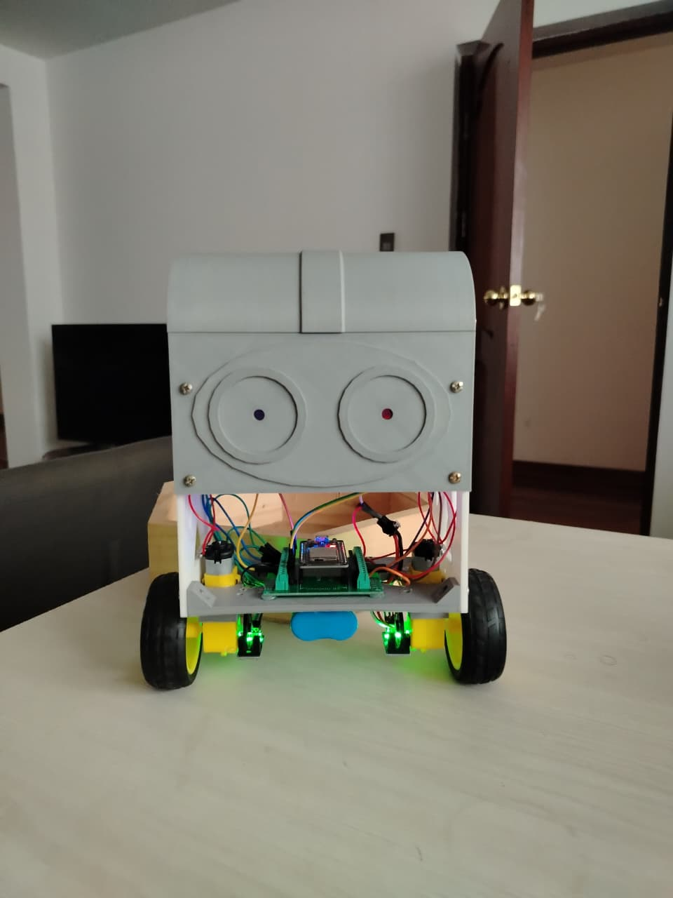
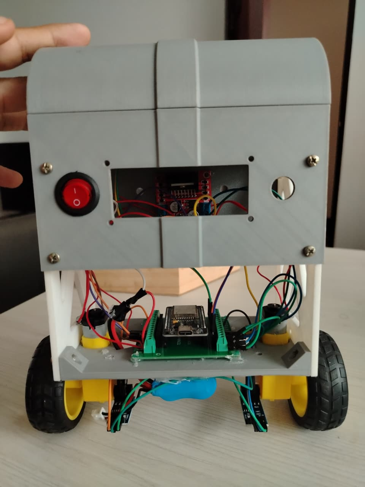
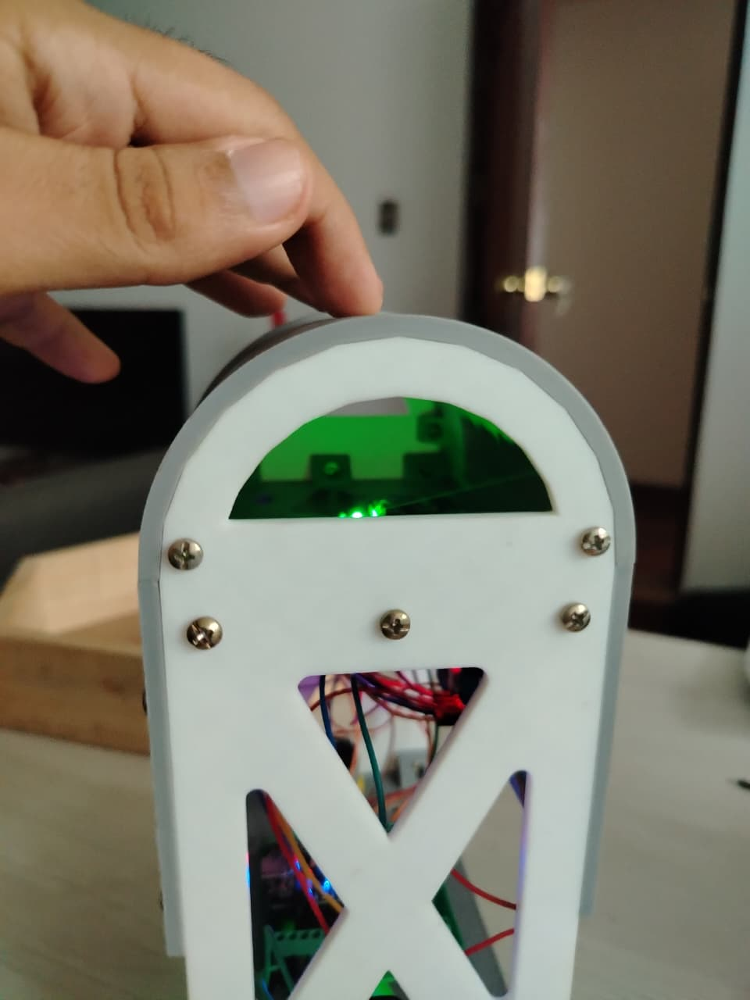
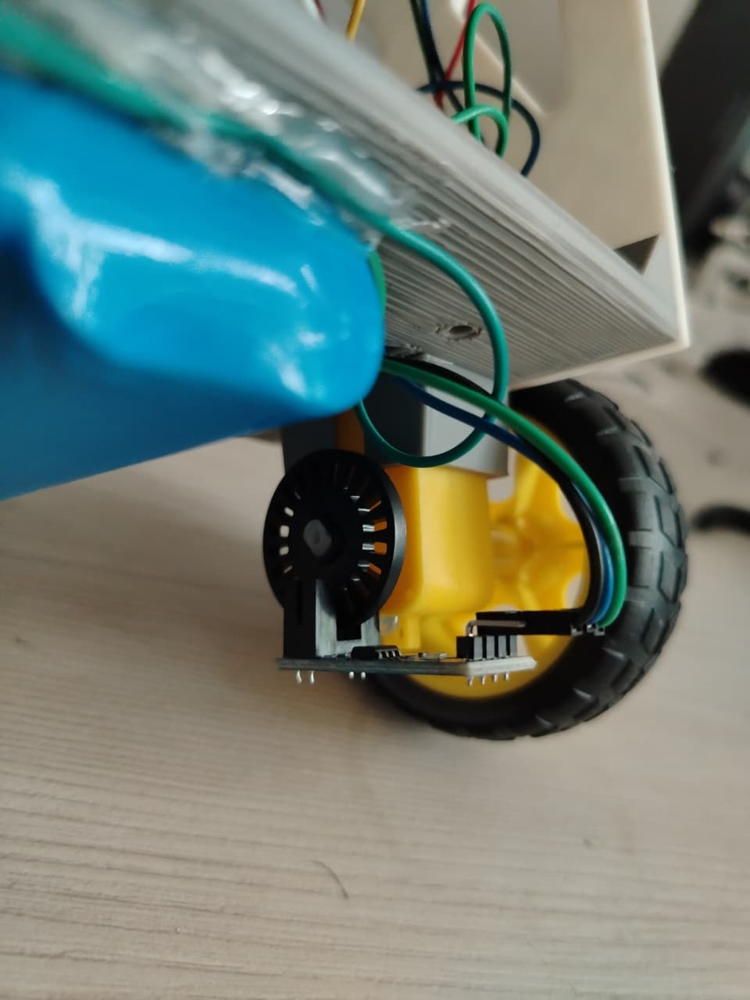
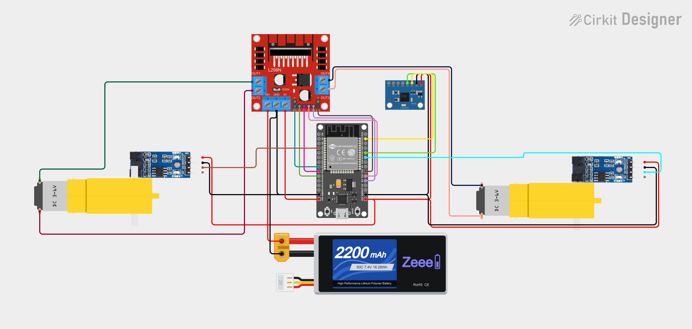

# Robot Balancín (Self-balancing robot)

Proyecto de diseño mecánico en impresión 3D, modelado matemático, identificación experimental de sistemas y control en lazo cerrado sobre un péndulo invertido sobre dos ruedas impulsado por **ESP32**. Diseñado por Daniel Vásquez Zapata y Ender Ruiz Herrera, alumnos de la Universidad Nacional de Trujillo.
Este proyecto presenta una aplicación para controlar el robot y que haga más movimientos además de mantenerse estable.

**[Abrir Aplicación](https://dano-code-max.github.io/robot_balancin_unt/)**

---

# Pruebas de Funcionamiento

### 1. Control en Cascada de Ángulo y Posición Lineal
<video src="https://github.com/Dano-code-max/robot_balancin_unt/raw/main/media/ControlAnguloPosicion.mp4" controls width="360"></video>

### 2. Control de Orientación y Rechazo de Perturbaciones (Yaw)
<video src="https://github.com/Dano-code-max/robot_balancin_unt/raw/main/media/ControlYaw.mp4" controls width="360"></video>

### 3. Telemetría en Tiempo Real y Control desde la App Móvil
<video src="https://github.com/Dano-code-max/robot_balancin_unt/raw/main/media/FuncionamientoAplicacion.mp4" controls width="360"></video>

---

# Galería de Construcción y Hardware

| Vista Frontal del Chasis | Vista Posterior y Electrónica |
| :---: | :---: |
|  |  |

| Montaje del Sensor IMU (MPU-6050) | Montaje de Encoders Ópticos |
| :---: | :---: |
|  |  |

---

# Diagrama de Conexiones (ESP32 de 30 pines)

| Componente | Pin ESP32 | Función |
| :--- | :--- | :--- |
| **MPU-6050 (SDA / SCL)** | `GPIO 21` / `GPIO 22` | Bus I2C a 400 kHz (Ángulo Pitch y Giro Z) |
| **Encoder Izquierdo** | `GPIO 34` | Interrupción externa (pulsos rueda izq.) |
| **Encoder Derecho** | `GPIO 19` | Interrupción externa (pulsos rueda der.) |
| **Puente H (ENA, IN1, IN2)** | `GPIO 25, 27, 26` | PWM y sentido Motor Izquierdo |
| **Puente H (ENB, IN3, IN4)** | `GPIO 17, 16, 4` | PWM y sentido Motor Derecho |
| **Alimentación** | Batería Li-Ion `7.4 V` | Etapa de potencia para motores TT |

---

## 📂 Estructura del Repositorio
* **`/` (Raíz):** Aplicación Web Progresiva (`index.html`, `app.js`, `style.css`, `manifest.json`) lista para instalar en Android.
* **`/firmware`:** Código fuente completo en C++ para Arduino IDE.
* **`/stl's`:** Piezas diseñadas en CAD listas para impresión 3D.
* **`/electronics`:** Esquemas de cableado y distribución de pines.
* **`/media`:** Fotografías de montaje y videos de validación experimental.

---

## 🚀 Cómo usar la App Móvil
1. Enciende el robot y déjalo calibrar en una superficie plana durante 5 segundos.
2. Abre **[este enlace](https://dano-code-max.github.io/robot_balancin_unt/)** desde **Google Chrome** en Android (con Bluetooth y Ubicación activados).
3. Toca **Conectar BT** y selecciona **`RobotBalancin_UNT`**.
